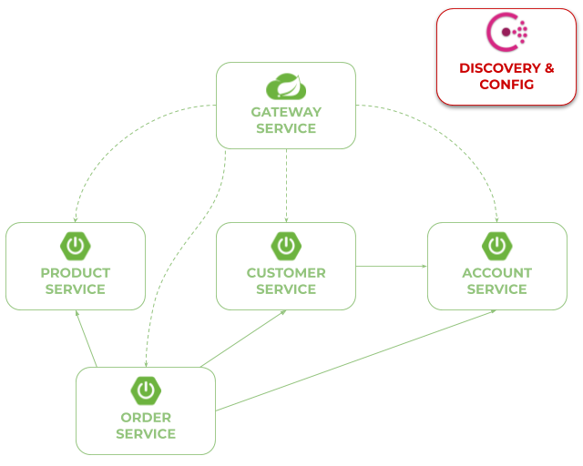
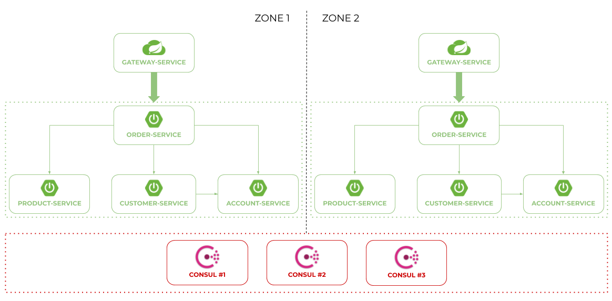
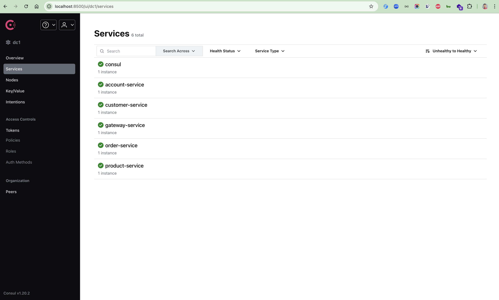

# Spring Cloud Consul Sample

[](https://github.com/hendisantika/spring-cloud-consul-sample/actions/workflows/maven.yml)


In this project I'm demonstrating you how to use Hashicorp's **Consul** as a discovery and configuration server
with [Spring Cloud Consul](https://spring.io/projects/spring-cloud-consul) and other Spring Cloud projects for building
microservice-based architecture.

## Tech Stack

| Component                | Version / Notes                                           |
|--------------------------|-----------------------------------------------------------|
| Java                     | **25** (Temurin recommended)                              |
| Spring Boot              | 4.1.2 (Jackson 3)                                         |
| Spring Cloud             | 2025.1.4 (Consul, OpenFeign, LoadBalancer, Gateway)       |
| Spring Cloud Gateway     | `spring-cloud-starter-gateway-server-webflux`             |
| Build tool               | Maven (wrapper `./mvnw` included in each service)         |
| Testing                  | JUnit 5, Testcontainers (Consul), Hoverfly, TestRestTemplate |

## Prerequisites

- JDK 25
- Maven 3.9+ (or use the bundled `./mvnw`)
- Docker (to run Consul and the Testcontainers-based integration tests)

## Getting Started

1. Run Consul in a Docker container:

   ```shell
   docker run -d --name consul-1 -p 8500:8500 -e CONSUL_BIND_INTERFACE=eth0 hashicorp/consul
   ```

   The Consul UI is then available at http://localhost:8500.

2. Build and test a service (repeat for each service directory):

   ```shell
   cd account-service
   ./mvnw clean verify
   ```

3. Run a service with Maven or as a jar:

   ```shell
   ./mvnw spring-boot:run
   # or
   java -jar target/account-service-0.0.1-SNAPSHOT.jar
   ```

   You can also import each service into your IDE (IntelliJ IDEA, Eclipse, VS Code) and run it from there.

## Services & Ports

| Service              | Port | Description                                                                  |
|----------------------|------|------------------------------------------------------------------------------|
| **account-service**  | 8080 | CRUD operations on an in-memory repository of accounts                       |
| **customer-service** | 8081 | CRUD operations on customers; calls `account-service`                        |
| **gateway-service**  | 8082 | Spring Cloud Gateway acting as the proxy/entry point for the system          |
| **order-service**    | 8083 | CRUD operations on orders; calls all other microservices                     |
| **product-service**  | 8084 | CRUD operations on an in-memory repository of products                       |

All services register in Consul and read their configuration from the Consul KV store
(`spring.config.import=optional:consul:`). Inter-service calls use OpenFeign with Spring Cloud LoadBalancer
backed by Consul discovery.

## Architecture

Our sample microservices-based system consists of the following modules:

- **gateway-service** - a module that uses Spring Cloud Gateway for running Spring Boot application that acts as a
  proxy/gateway in our architecture. Routes are configured under `spring.cloud.gateway.server.webflux.routes`.
- **account-service** - a module containing the first of our sample microservices that allows to perform CRUD operation
  on in-memory repository of accounts
- **customer-service** - a module containing the second of our sample microservices that allows to perform CRUD
  operation on in-memory repository of customers. It communicates with account-service.
- **product-service** - a module containing the third of our sample microservices that allows to perform CRUD operation
  on in-memory repository of products.
- **order-service** - a module containing the fourth of our sample microservices that allows to perform CRUD operation
  on in-memory repository of orders. It communicates with all other microservices.

The following picture illustrates the architecture described above.



When running sample applications we can test more advanced scenario. We may leverage **Zone Affinity** mechanism to
prefer communication inside a single zone. We can also start a cluster of Consul modes started locally on Docker
containers. Here's the picture illustrating such an architecture:





## Testing

Integration tests start a real Consul instance with [Testcontainers](https://testcontainers.com/) and mock downstream
services with [Hoverfly](https://hoverfly.io/), so **Docker must be running** before you execute:

```shell
./mvnw verify
```

## Continuous Integration

The [GitHub Actions workflow](.github/workflows/maven.yml) builds and tests every service on **JDK 25** using a
per-service matrix (`mvn -B verify`). On pushes to `main` it also submits each service's dependency graph to GitHub
so Dependabot alerts are accurate.

## Dependency Updates

[Dependabot](.github/dependabot.yml) checks for updates daily at 05:00 (Asia/Jakarta):

- **Maven** - one configuration covering all five services, with grouped PRs for Spring Boot, Spring Cloud,
  Testcontainers, test libraries and other minor/patch updates.
- **GitHub Actions** - all action updates grouped into a single PR.

Commit messages follow [Conventional Commits](https://www.conventionalcommits.org/) (`build(deps)`, `ci(deps)`).

## Migration Notes (Spring Boot 4 / JDK 25)

- Jackson 3 is used: `ObjectMapper` lives in `tools.jackson.databind` and its exceptions are unchecked.
- `TestRestTemplate` moved to the `spring-boot-resttestclient` module
  (`org.springframework.boot.resttestclient.TestRestTemplate`) and needs `@AutoConfigureTestRestTemplate`.
- Spring Cloud Gateway now uses `spring-cloud-starter-gateway-server-webflux` and the
  `spring.cloud.gateway.server.webflux.*` property prefix.
